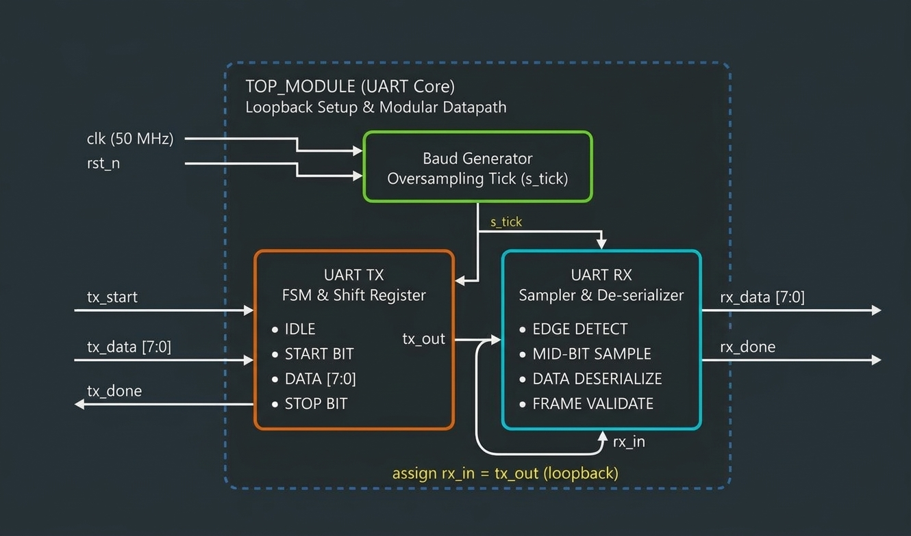
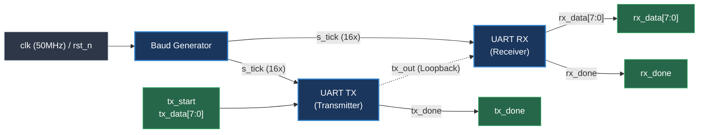
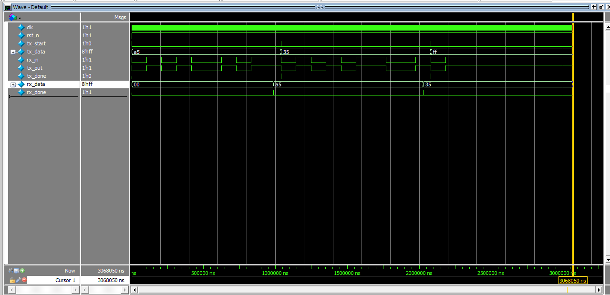

<div align="center">

# 🚀 Synthesizable UART Core (50 MHz, 8N1)

[](https://en.wikipedia.org/wiki/Verilog)
[]()
[]()
[]()

A modular, hardware-tested **UART Core (TX/RX/Baud Generator)** built with synthesizable Verilog and verified with an exhaustive self-checking testbench.

---

### 📌 Architecture Overview


</div>

---

## ⚡ Key Highlights & Specs

| Feature | Specification | Description |
| :--- | :--- | :--- |
| **System Clock** | `50 MHz` | Base system frequency |
| **Data Frame** | `8N1` | 1 Start bit, 8 Data bits, No parity, 1 Stop bit |
| **Oversampling**| `16x` | 16 sample ticks per bit for robust noise rejection & mid-bit capture |
| **Architecture**| Modular FSM | Independent TX & RX state machines (`IDLE`, `START`, `DATA`, `STOP`) |
| **Verification**| Self-Checking TB | Automated checks with zero-assertion tolerance |

---

## 🔄 Dataflow & Modular Structure



---

## 🧪 Verification & Simulation Results

The core was validated using **QuestaSim** via directed test cases covering reset assertion, frame synchronization, and **back-to-back concurrent transmission** using non-blocking TB threads (`fork ... join`).

<div align="center">
  
</div>

```text
[40 ns]       : Reset Verification -> PASSED ✓
[988050 ns]   : Single Byte Loopback -> PASSED ✓
[2028050 ns]  : Back-to-Back (Byte 1: 0x35) -> PASSED ✓
[3068050 ns]  : Back-to-Back (Byte 2: 0xFF) -> PASSED ✓
======================================================
>> ALL TESTCASES COMPLETED SUCCESSFULLY [0 ERRORS] <<
```

---

## 📂 Project Structure

```bash
├── RTL/          # Synthesizable RTL source files (top, tx, rx, baud)
├── tb/           # Self-checking testbench (tb.v)
├── sim/          # QuestaSim / ModelSim execution script (run.do)
├── docs/         # Architectural diagrams & simulation wave captures
└── README.md     # Project documentation
```
